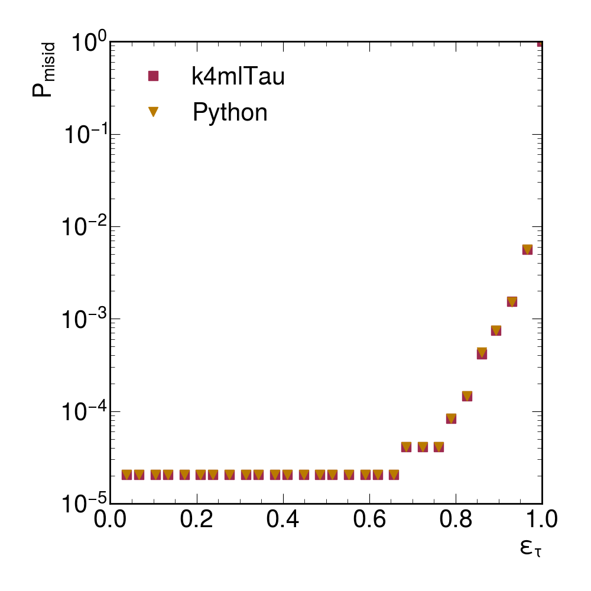
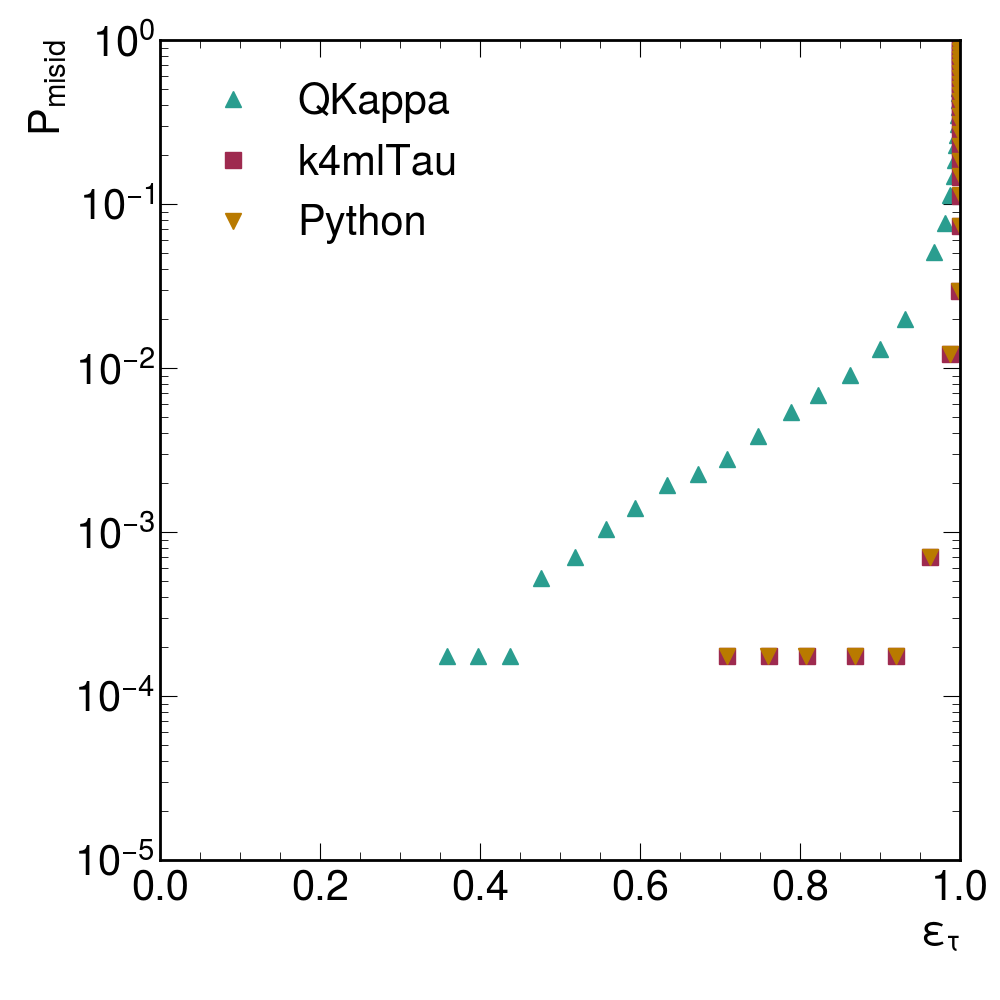
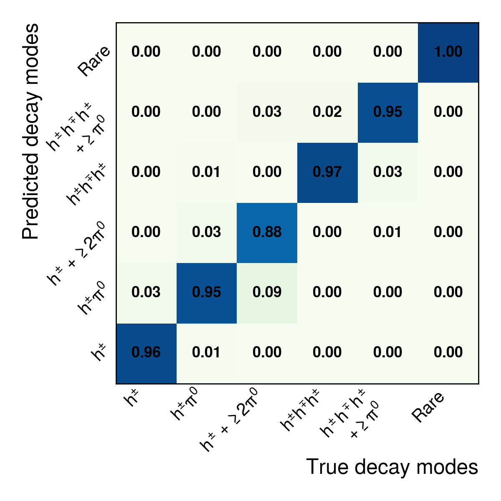
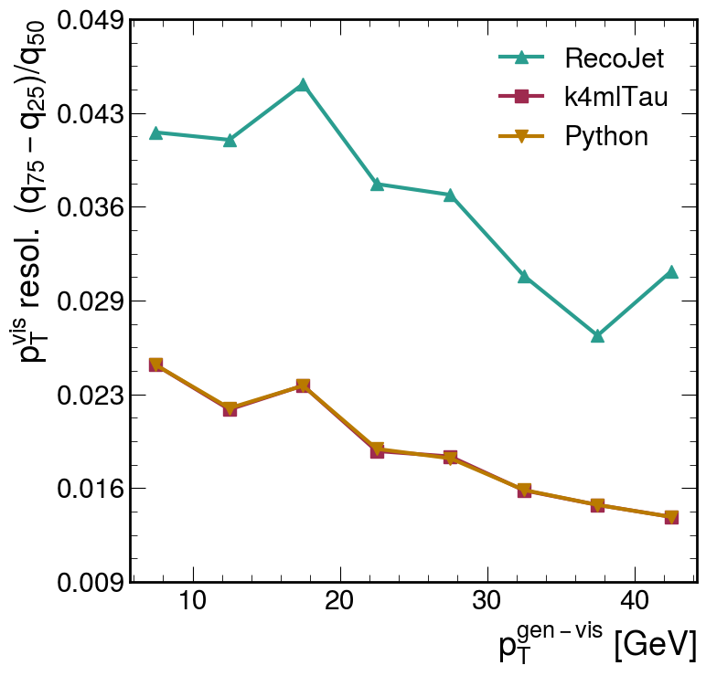
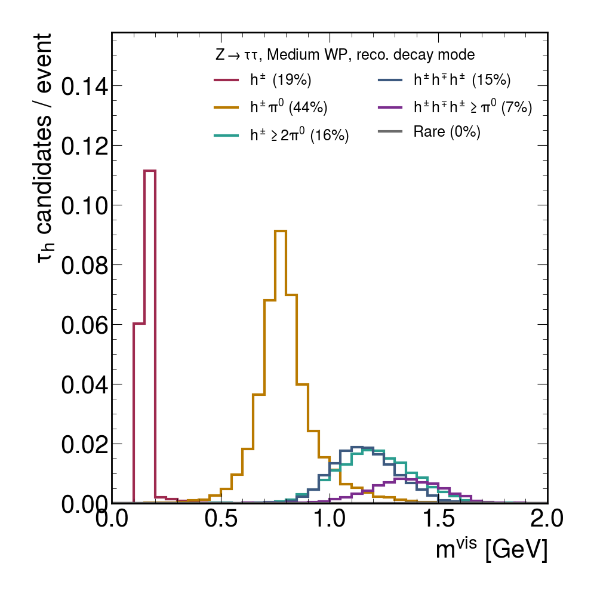
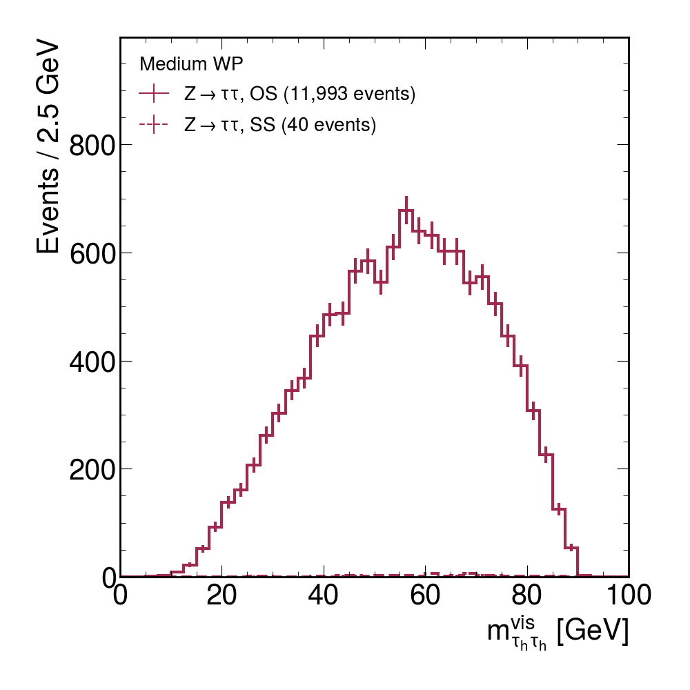

# k4mlTau

k4mlTau reconstructs hadronic tau leptons (τh) in Key4hep. It runs the
**MultiParTau** model from the paper
[*ParticleTransformer is all you need for reconstructing hadronic tau leptons*](https://arxiv.org/abs/2606.18460)
on EDM4hep files (e.g. CLD reconstruction) and writes for every jet:

- the **τh ID score** (is it a τh or a quark/gluon jet?)
- the **charge** (+1 / −1)
- the **decay mode** (h±, h±π⁰, h±≥2π⁰, 3h±, 3h±≥π⁰, rare)
- the **visible 4-momentum** (pT, η, φ, mass)

```text
PandoraPFOs ──► seed jets (anti-kt, R = 0.4) ──► MultiParTau (ONNX, CPU) ──► mlTau + mlTauID
```

The input files must contain `PandoraPFOs`, `SiTracks_Refitted` and
`PrimaryVertices` (standard CLD reconstruction).

## 1. Install

**Clone the repository**

```bash
git clone https://github.com/nseeba/k4mlTau.git
cd k4mlTau
```

> **Note (branch `vertex_fix_model`):** this branch adds support for the new MultiParTau trained on the
> vertex-corrected Fuτure v3 (the plots in [Performance](#5-performance) are from this model). Its model file
> will be uploaded as a new release later. Until then, the commands below download the preprint model
> (release v0.1.0), which also runs with this branch and gives the same results as on `main`.

**Download the model** (from the release
[v0.1.0](https://github.com/nseeba/k4mlTau/releases/tag/v0.1.0)) into `models/`:

```bash
mkdir -p models
cd models
wget https://github.com/nseeba/k4mlTau/releases/download/v0.1.0/mlTau_0612_multipartau_full_b8483f6.tar.gz
wget https://github.com/nseeba/k4mlTau/releases/download/v0.1.0/mlTau_0612_multipartau_full_b8483f6.tar.gz.sha256
sha256sum -c mlTau_0612_multipartau_full_b8483f6.tar.gz.sha256   # should print "OK"
tar -xzf mlTau_0612_multipartau_full_b8483f6.tar.gz
cd ..
```

**Build**

```bash
source /cvmfs/sw.hsf.org/key4hep/setup.sh -r 2026-04-08
cmake -B build -S . -DCMAKE_INSTALL_PREFIX=install
cmake --build build --target install -j4
source setup.sh
```

**In every new terminal**, set up the environment again:

```bash
cd k4mlTau
source /cvmfs/sw.hsf.org/key4hep/setup.sh -r 2026-04-08
source setup.sh
```

## 2. Run

Run on all `.root` files in a directory:

```bash
python3 scripts/run_mltau.py \
  --input-dir /path/to/input/files \
  --output-dir /path/to/output
```

This writes `mltau_000000.root`, `mltau_000001.root`, … to the output directory
(by default one output file per 20 input files; change it with
`--files-per-output`). One input file of 100 events takes up to ~30 s. The
output files contain the full input events, so they are about as large as the
input files together.

**On a batch system**, add `--workflow`. Each output file becomes one job:

```bash
python3 scripts/run_mltau.py --workflow slurm  --input-dir <dir> --output-dir <dir>   # Slurm
python3 scripts/run_mltau.py --workflow condor --input-dir <dir> --output-dir <dir>   # HTCondor (lxplus)
```

Check the jobs with `squeue -u $USER` (Slurm) or `condor_q` (HTCondor). Add
`--dry-run` to see what would be submitted without submitting it. All options are
listed in [docs/details.md](docs/details.md#runner-options-scriptsrun_mltaupy).

**Check the output**

```bash
podio-dump /path/to/output/mltau_000000.root | grep mlTau
```

## 3. Running on lxplus

The commands are the same. Put the code, the build and the model on **AFS**
(your home or work area) and the input and output ROOT files on **EOS**
(`/eos/user/<x>/<user>/...`). HTCondor logs go to `condor_logs/` in the
repository, because they cannot be written to EOS.

Example:

```bash
python3 scripts/run_mltau.py --workflow condor \
  --input-dir /eos/user/<x>/<user>/inputs \
  --output-dir /eos/user/<x>/<user>/outputs
```

## 4. Output

Each output file contains the complete input events (all collections, e.g.
`MCParticles` and `RecoMCTruthLink`) plus three new collections. The new
collections have one entry per seed jet, in the same order:

| Collection | Content |
| --- | --- |
| `mlTauSeedJets` | the seed jets |
| `mlTau` | τh candidates: 4-momentum, `charge`, τh ID score in `goodnessOfPID` |
| `mlTauID` | decay mode in `type`, τh ID score in `likelihood`, charge and decay-mode probabilities in `parameters` |

To select τh, cut on the τh ID score.

**Jets with an electron or muon** were not part of the training, so by default
the model is not run on them. They get score −1 and decay mode −1, keep the
4-momentum of the seed jet and get the charge of the lepton. Any score cut
removes them. Add `--no-lepton-veto` to run the model on all jets.

All fields, options and the model interface: [docs/details.md](docs/details.md).

## 5. Performance

Validation of the new MultiParTau (vertex-corrected Fuτure v3; model file to be released) on 50 000 Z → ττ
and 50 000 Z → qq events (CLD full simulation, √s = 91 GeV). The four tasks are evaluated as in the paper, on the test-split
jets. k4mlTau reproduces the Python model (scores agree to ~10⁻⁷).

<table>
  <tr>
    <td align="center"><br>τh identification: mis-ID rate of q/g jets vs τh efficiency</td>
    <td align="center"><br>Charge: mis-ID rate vs efficiency (QKappa = classical jet charge)</td>
  </tr>
  <tr>
    <td align="center"><br>Decay mode: how each true decay mode (column) is classified</td>
    <td align="center"><br>Visible pT resolution, compared with the seed jet (RecoJet)</td>
  </tr>
</table>

The τh candidates with a τh ID score ≥ 0.94 (80% efficiency for true τh):

<table>
  <tr>
    <td align="center"><br>Visible τh mass per reconstructed decay mode: π±, ρ and a1 peaks</td>
    <td align="center"><br>Visible di-τh mass; same-sign (SS) pairs come from a wrong charge or a fake</td>
  </tr>
</table>
